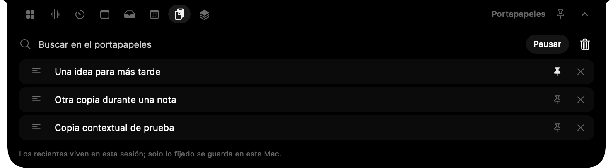
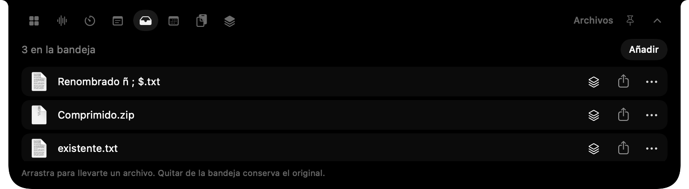
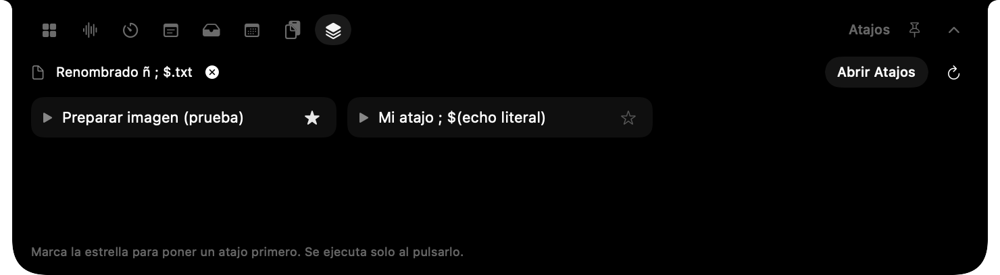

# ISLA

**Tu música, archivos y herramientas, a un gesto del notch.**

ISLA es una app nativa de macOS que despliega una isla al acercar el puntero al centro superior de la pantalla. Reúne música, batería, calendario, notas, portapapeles, archivos y Atajos en un panel horizontal.

**0.13.0 · Beta · Apple Silicon e Intel · Licencia MIT**



## Qué puedes hacer

| Módulo | Funciones |
|---|---|
| Música | Apple Music y Spotify, portada, fuente, progreso, controles y letras sincronizadas cuando están disponibles. |
| Controles | Batería real del Mac, prioridad de un iPhone disponible y volumen cuando la salida de audio permite cambiarlo. |
| Calendario | Mes completo y agenda de los calendarios configurados en macOS, con autorización. |
| Foco y notas | Temporizadores de 5, 25 y 50 minutos y una nota local compartida entre pantallas. |
| Portapapeles | Historial opcional de texto, enlaces e imágenes; búsqueda, copia y elementos fijados. |
| Archivos | Bandeja con arrastre, Vista previa, renombrado, ZIP, compartir y entrada para Atajos. |
| Atajos | Botones para los atajos de Apple de tu Mac, favoritos y ejecución con un archivo de entrada. |

## Discreta cuando no la necesitas

En un Mac con notch, el modo compacto muestra actividad musical a la izquierda y batería a la derecha, dejando libre el área de la cámara. En una pantalla externa **queda totalmente oculta y deja libre la barra de menús** hasta que acercas el puntero al centro superior.

Cada pantalla tiene su propia apertura, pestaña y pin; ambas comparten los datos. La isla permanece abierta mientras el puntero recorre su contenido. Al retirarlo, se cierra tras una breve espera. El pin permite mantenerla abierta y la flecha o Esc la contraen.

La apertura es contextual: acercar un archivo arrastrándolo abre la bandeja; una copia reciente puede abrir Portapapeles en el siguiente acercamiento. Una copia nueva no cambia la pestaña que ya estás usando. Copiar o terminar un Atajo no revela por sí solo la pantalla externa.

## Instalación

1. Descarga `ISLA-0.13.0-macOS-universal.zip` desde [Releases](https://github.com/patrickneocreative-beep/Dinamic-Island/releases).
2. Descomprime el archivo, mueve `ISLA.app` a Aplicaciones y ábrela.
3. Acerca el cursor al notch o al centro del borde superior de tu monitor externo.
4. Conecta los módulos que quieras usar. Portapapeles empieza desactivado: pulsa **Activar historial** para guardar nuevas copias.

El mínimo declarado es **macOS 14**. Liquid Glass se usa en controles compatibles desde macOS 26. La app está compilada para Apple Silicon e Intel; la validación de escritorio se realizó en Apple Silicon, no en todas las versiones de macOS ni en hardware Intel.

La beta lleva firma local **ad hoc**, sin notarización de Apple. Consulta [instalación y permisos](docs/INSTALL.md) si macOS bloquea la apertura. No hace falta desactivar Gatekeeper.

## Privacidad y límites

- El historial reciente del portapapeles vive en memoria; solo lo fijado se guarda en este Mac. Se omiten los tipos marcados como confidenciales por la app de origen, pero no se detectan todos los secretos copiados como texto normal.
- Las letras se consultan en **LRCLIB** usando los metadatos de la canción. Las portadas de Spotify pueden descargarse de la dirección proporcionada por Spotify. Consulta [Privacidad](PRIVACY.md) para conocer los datos locales y las conexiones.
- Calendario consulta eventos mediante EventKit. No crea, modifica ni elimina eventos.
- La batería del iPhone utiliza el framework privado MobileDevice. USB se ha comprobado; **Wi‑Fi es experimental y sigue pendiente de validación física**. Estar en la misma red no basta: macOS debe ofrecer una conexión autorizada.
- Las letras dependen de cada canción. Se puede importar un archivo LRC como alternativa.
- Los Atajos se ejecutan solo al pulsarlos. Sus permisos, preguntas y acciones dependen del atajo elegido.

## Capturas

Las siguientes imágenes son capturas de la interfaz nativa con datos de demostración.





## Compilar

Se necesita macOS, el SDK de macOS **26 o posterior** y el compilador Swift de Xcode o de sus herramientas de línea de comandos. No hay dependencias de Homebrew, Swift Package Manager ni servicios de pago.

Desde la carpeta del repositorio:

```sh
bash build.sh
open build/ISLA.app
```

El script compila `arm64` y `x86_64`, genera una app universal, aplica firma ad hoc, verifica la firma y ejecuta las comprobaciones internas. No instala ni sustituye otras copias de ISLA.

Para crear un ZIP de distribución y su SHA-256:

```sh
bash scripts/package.sh
```

Los resultados quedan en `dist/`, fuera de Git. El identificador `local.isla.prototype` se conserva para mantener los datos de las betas existentes; si cambias ese identificador, los permisos y las preferencias pueden pertenecer a otra app.

## Pruebas y colaboración

[Guía de pruebas](docs/TESTING.md) · [Arquitectura](docs/ARCHITECTURE.md) · [Cómo contribuir](CONTRIBUTING.md) · [Cambios](CHANGELOG.md) · [Publicar una release](docs/PUBLISHING.md)

La automatización de GitHub compila y ejecuta las comprobaciones internas. El workflow `Publish beta` empaqueta y publica cada versión nueva como prerelease; conserva los archivos de las versiones ya publicadas. Las pruebas de interacción con ventanas, dispositivos y aplicaciones externas se realizan por separado en una sesión gráfica. No se presenta una ejecución local como si fuera un resultado de GitHub Actions.

## Licencia y créditos

Copyright © 2026 Patrick Flores. Código y recursos propios bajo [licencia MIT](LICENSE).

ISLA es un proyecto independiente, sin afiliación con Apple o Spotify. Los nombres y recursos de terceros conservan sus derechos. Véanse [créditos e integraciones](ACKNOWLEDGMENTS.md).
