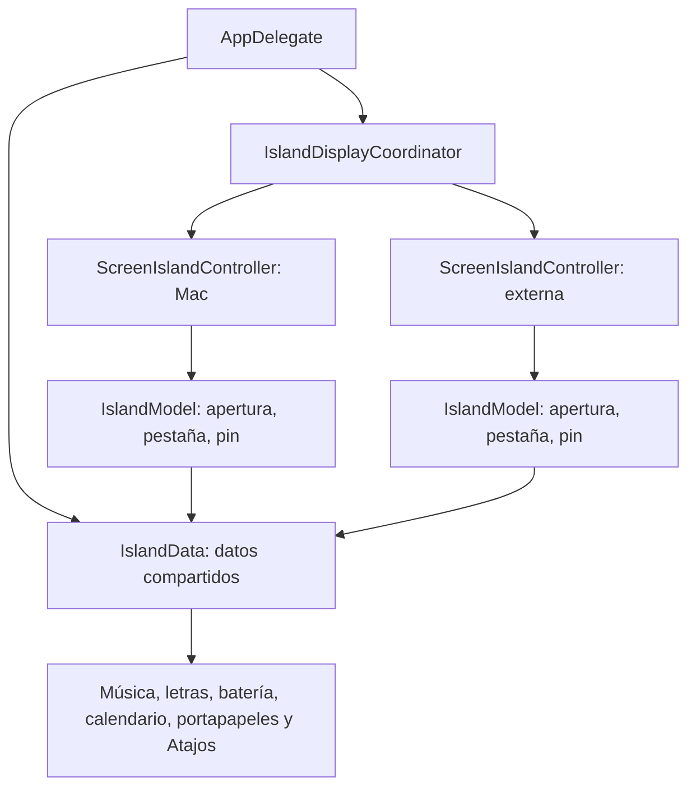

# Arquitectura

ISLA es un ejecutable Swift con AppKit y SwiftUI. `IslaApp.swift` crea una app accesoria con menú de barra y coordina sus servicios. No hay un servidor ni un framework web.

## Ventanas y puntero

`ScreenIslandController` mantiene un `NSPanel` por rectángulo de pantalla; las pantallas en espejo no duplican ventanas. En una pantalla externa, el panel cerrado está ordenado fuera de pantalla, con alfa cero y sin interceptar eventos.

`WindowPointerTracker` comprueba la posición global cada 80 ms, además de los eventos de movimiento. El área de activación existe aunque la ventana esté oculta. `ScreenPointerRegion` incluye el borde superior exacto y excluye el límite horizontal derecho; esto evita perder el cursor cuando llega al tope y diferencia pantallas contiguas.

`IslandModel` gestiona las esperas de apertura/cierre, el pin, la interacción con diálogos y la supresión temporal tras un cierre manual. `IslandWindowMotion` anima una sola geometría con el borde superior fijo. `IslandHostingView` deja el tamaño a la ventana nativa.

## Contexto y estado compartido

`IslandData` tiene una sola instancia por app. Notas, bandeja, temporizador y servicios son compartidos; cada `IslandModel` conserva su pestaña y apertura. Un evento de portapapeles registra su fecha, pero no expande ventanas. Al siguiente hover, el arrastre de archivos tiene prioridad y una copia reciente puede elegir Portapapeles durante 25 segundos. Cada pantalla consume ese contexto de forma independiente.

Las finalizaciones de procesos solo actualizan sus estados. Las peticiones explícitas del usuario, como el menú de ISLA o añadir archivos, pueden abrir una sección. Un archivo cuya entrega de arrastre termina tarde no reabre una isla ya cerrada.

## Integraciones

- `MediaService` consulta Apple Music y Spotify con AppleScript en una cola dedicada. `LyricsService` solicita letras por HTTPS y permite LRC local.
- `SystemServices` consulta batería/volumen. `IPhoneBatteryService` carga MobileDevice dinámicamente y usa un hilo propio con run loop. Si faltan símbolos, informa de la indisponibilidad.
- `CalendarService` usa EventKit para leer eventos autorizados.
- `ClipboardService` observa NSPasteboard, filtra tipos privados, deduplica y limita el historial. Solo persiste los fijados.
- `ShortcutsService` enumera y ejecuta el CLI de Apple con identificadores y argumentos separados. `LocalCommand` trabaja fuera del hilo principal y limita la espera.
- `FileActions` integra Vista previa, compartir, renombrado y ZIP. Las operaciones no reemplazan destinos existentes.

Los estados de prueba se inyectan mediante `preview` y servicios aislados. No deben activarse desde la interfaz de la app real.
